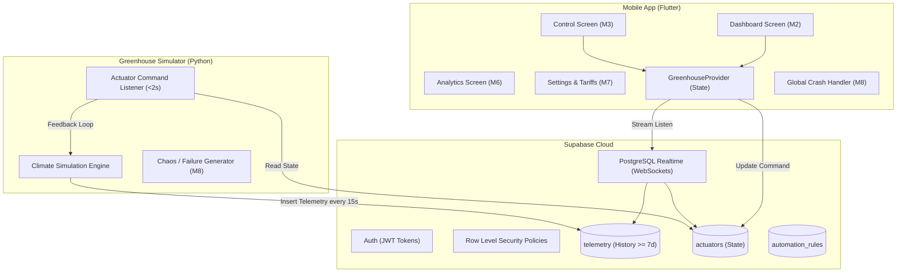

# 🏛️ GreenLand Architecture & Data Flow Specification

## 1. System Overview
The GreenLand ecosystem connects the mobile client, cloud database, and greenhouse microclimate simulator.

## 2. Latency & Non-Functional Guarantees
* **Command Latency:** App $\rightarrow$ Supabase $\rightarrow$ Simulator latency $< 2$ seconds (Brief limit: $< 5$ seconds).
* **Cold Start:** Flutter AOT compilation and lightweight initial tree ensure cold start $< 2.5$ seconds (Brief limit: $< 3$ seconds).
* **Crash Resilience:** All state transitions and stream subscriptions are wrapped in defensive try-catch handlers to strictly satisfy Module M8.
